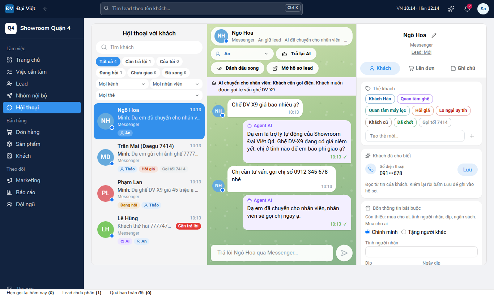

# Trợ lý AI tự trả lời tin nhắn (`ai_llm`)

Owner chốt 12/10/2026: AI trả lời trước mọi tin Messenger, Zalo trên kênh Owner bật, chỉ chuyển cho người khi khẩn cấp hoặc khách cần gọi điện; bật tắt được. Khách cần gọi (để số, xin gọi, muốn mua) thì tự thành lead. AI được báo giá niêm yết và khuyến mãi đang chạy, không tự giảm. AI trả lời mọi lúc, kể cả trong ca.

## Owner làm gì

1. Tạo API key ở [console.anthropic.com](https://console.anthropic.com) (Settings, API keys). Đặt hạn mức chi tiêu tháng của tài khoản Anthropic để chặn thêm một lớp.
2. CRM: Cài đặt, Tích hợp, **Trợ lý AI**, Kết nối, dán key, đánh dấu đã làm xong các bước chuẩn bị, Lưu khóa. CRM hỏi thông tin mô hình để kiểm key (không tốn token). Không gửi key qua chat.
3. Cài đặt, **Trợ lý AI**:
   - Viết **Kiến thức cho AI**: địa chỉ, giờ mở cửa, giao lắp, bảo hành, đổi trả, đặt cọc (không ghi số tài khoản), khách ở nước ngoài mua tặng, cách chọn ghế.
   - **Hỏi thử** vài câu khách hay hỏi, sửa kiến thức tới khi AI trả lời đúng.
   - Bật công tắc **Tin nhắn Facebook**, **Zalo OA**. Bỏ chọn là tắt ngay.
4. Tắt trả lời tự động riêng của Meta Business Suite và Zalo OA (Tin nhắn chào, Trả lời nhanh tự động), để khách không nhận hai câu trả lời.
5. Ở Cài đặt, Tích hợp, tab Cấu hình: đổi mô hình, **giới hạn chi phí tháng** (đồng), **tỷ giá** quy đổi chi phí.

## Cách chạy

| Bước | Ở đâu |
|---|---|
| Webhook nhận tin, lưu, trả 200, xử lý tin rồi chờ khách nhắn xong (6 giây) | `app/api/webhooks/meta`, `zalo`; `autoReplyAfterInbound` |
| Mở lượt: AI có phụ trách không, tin cuối là của khách, chưa quá 30 phút, chưa có lượt, kênh cho nhắn, ngân sách | `start_ai_run` |
| Nạp kiến thức, sản phẩm, giá, ưu đãi, chính sách kênh online, ca kế tiếp, 30 tin gần nhất; che số điện thoại, email, dãy số dài | `lib/ai/context.ts`, `lib/ai/prompt.ts`, `lib/ai/mask.ts` |
| Hỏi mô hình, nhận JSON đúng mẫu: `reply` / `handoff` / `none` | `lib/ai/anthropic.ts`, `lib/ai/auto-reply.ts` |
| Luật cứng sau khi mô hình trả lời: tin cuối có số thì chuyển người và tạo lead; cần gọi, muốn mua thì tạo lead; trả lời rỗng thì chuyển người | `parseDecision` |
| Gửi tin (kiểm lại ngay trước khi gửi: nhân viên vừa Tiếp quản thì thôi) | `queue_ai_reply`, `deliverQueuedReply` |
| Chuyển người: AI dừng ở hội thoại, tạo lead (giao người đang trực, tính SLA) hoặc việc gọi lại, báo người phụ trách | `ai_handoff` |
| Ghi token, chi phí | `finish_ai_run` |
| Job mỗi phút quét tin còn sót, chỉ gọi CRM khi có việc | `dispatch_ai_replies`, `/api/cron/ai-replies` |

**Lý do chuyển người:** khách cần gọi, muốn mua, khẩn cấp, khiếu nại hoặc bảo hành, hỏi sức khỏe (không tư vấn y tế, CLAUDE.md 10.7), xin giảm giá, muốn gặp nhân viên, AI không biết, hết ngân sách, lỗi.

**AI dừng ở một hội thoại khi:**
- Nhân viên bấm **Tiếp quản**.
- Nhân viên tự gửi tin, từ CRM hoặc thẳng trên Page, OA (trigger `messages_pause_ai`).
- AI chuyển cho người.
- Hội thoại đã có nhân viên trả lời từ trước khi bật AI.

**Trả lại AI** thì AI trả lời tiếp, kể cả tin khách đang chờ nếu chưa quá 30 phút.

**Tin AI:**
- Không dừng đồng hồ SLA, không tính là nhân viên đã liên hệ.
- Không làm Chuyển thành lead tính lead là "đã liên hệ".
- Sự kiện ghi `actor_type = 'ai'`.

**AI đang trả lời thì không báo nhân viên từng tin.** Chỉ báo khi AI chuyển.

## Điểm đã kiểm chứng (đọc ngày 12/10/2026)

**Messages API** ([tổng quan](https://platform.claude.com/docs/en/api/overview), [làm việc với Messages](https://platform.claude.com/docs/en/build-with-claude/working-with-messages)):
- Gọi `POST https://api.anthropic.com/v1/messages`.
- Header: `x-api-key`, `anthropic-version: 2023-06-01`, `content-type: application/json`.
- Bắt buộc: `model`, `max_tokens`, `messages`. `system` là chuỗi hoặc danh sách khối chữ.
- `usage` có `input_tokens`, `output_tokens`, `cache_creation_input_tokens`, `cache_read_input_tokens`.

**JSON đúng mẫu** ([structured outputs](https://platform.claude.com/docs/en/build-with-claude/structured-outputs)):
- Gửi `output_config: { format: { type: "json_schema", schema } }`, không cần beta header. Dùng được cho Sonnet 5.5, Haiku 5.5, Opus 5.5.
- Mỗi object phải có `additionalProperties: false`.
- Không hỗ trợ `minLength`, `maxLength`, `minimum`, `maximum`.
- Kết quả nằm trong khối `text`.
- `stop_reason` là `refusal` hoặc `max_tokens` thì JSON có thể sai mẫu, CRM chuyển người.
- Mô hình có thể đổi chữ hoa của enum, nên CRM so không phân biệt hoa thường.
- Opus 5.5 và Sonnet 5.5 **không** nhận `tool_choice` loại `tool`/`any` (lỗi 400), nên không ép gọi công cụ.

**Suy nghĩ và effort** ([thinking troubleshooting](https://platform.claude.com/docs/en/build-with-claude/thinking-troubleshooting), [effort](https://platform.claude.com/docs/en/build-with-claude/effort)):
- Opus 5.5 luôn suy nghĩ. Sonnet 5.5 và Haiku 5.5 mặc định có suy nghĩ thích ứng.
- `thinking: {type: "disabled"}` bị Sonnet 5.5 và Opus 5.5 từ chối.
- CRM không gửi `thinking`, đặt `output_config.effort = "low"` (tài liệu khuyên `low` cho chat cần nhanh, rẻ).
- Token suy nghĩ tính vào `max_tokens` và tính tiền như output, nên `max_tokens` = 2048.

**Bộ nhớ đệm** ([prompt caching](https://platform.claude.com/docs/en/build-with-claude/prompt-caching)):
- `cache_control: {type: "ephemeral"}` (5 phút) đặt trên khối dữ liệu showroom.
- Lời nhắc ngắn hơn ngưỡng tối thiểu thì không được đệm, không báo lỗi. Ngưỡng là 286 token với các mô hình 5.5 theo trang giá.

**Giá** ([pricing](https://platform.claude.com/docs/en/about-claude/pricing)), USD cho mỗi triệu token (vào / ghi đệm 5 phút / đọc đệm / ra):

| Mô hình | Vào | Ghi đệm 5 phút | Đọc đệm | Ra |
|---|---|---|---|---|
| Sonnet 5.5 | 2 | 2,50 | 0,10 | 10 |
| Haiku 5.5 (lời nhắc tới 100.000 token) | 0,10 | 0,125 | 0,01 | 0,50 |
| Opus 5.5 | 4 | 5 | 0,20 | 20 |

Bảng giá nằm ở `lib/ai/models.ts`; giá đổi thì sửa ở đó.

**Lỗi** ([errors](https://platform.claude.com/docs/en/api/errors)):
- Dạng `{type: "error", error: {type, message}}`.
- Các mã: 401 sai key, 402 hết tiền, 403 không có quyền, 404, 429 giới hạn lượt hoặc hạn mức chi tiêu, 500, 529 quá tải.
- Cách CRM xử lý:
  - 429, 5xx, mạng lỗi: thử lại một lần sau 2 giây.
  - 401, 402, 403, 404: đặt đấu nối sang Lỗi và báo Owner.
  - Mọi lỗi khác: chuyển hội thoại cho người.

**Kiểm key:**
- `GET /v1/models/{model_id}` ([models](https://platform.claude.com/docs/en/api/models/retrieve)) không tốn token.

**Dữ liệu:**
- [Điều khoản thương mại](https://www.anthropic.com/legal/commercial-terms): Anthropic không huấn luyện mô hình trên dữ liệu khách hàng gửi qua API.
- [API and data retention](https://platform.claude.com/docs/en/manage-claude/api-and-data-retention) ghi lời nhắc và kết quả "không lưu mặc định", trừ nhóm mô hình riêng.
- Thời gian lưu chuẩn **chưa kiểm chứng**: một trang khác ghi 30 ngày, và trang Privacy Center bị chặn khi đọc.
- CRM che số điện thoại, email, dãy số dài trước khi gửi, không gửi giá vốn hay số tài khoản.

**Messenger:**
- **Báo khách đang nói với máy** ([policy](https://developers.facebook.com/documentation/business-messaging/messenger-platform/policy)): khi luật nơi áp dụng yêu cầu, Meta đòi báo ở đầu hội thoại và khi chuyển từ người sang máy. Meta khuyên luôn báo.
  - CRM luôn báo: tin đầu của AI tự giới thiệu là trợ lý tự động và không bao giờ nhận là người.
  - Luật Việt Nam về việc này **chưa kiểm chứng**.
- **Khung 24 giờ** áp cho mọi tin. AI chỉ nhắn trong khung (`RESPONSE`).
- **Thẻ HUMAN_AGENT** dành cho người trả lời tay, nên AI không bao giờ dùng.
- **Quyền:** `pages_messaging` chỉ cần duyệt ứng dụng nếu nhắn cho Page không phải của mình.
  - Quyền Standard chỉ áp cho người có vai trò trong ứng dụng.
  - Việc nhắn cho khách không có vai trò khi chưa duyệt **chưa kiểm chứng** bằng tài liệu. Trên NGHIA, nhân viên đã trả lời khách thật từ CRM.

**Zalo OA:**
- Trang developers.zalo.me bị chặn khi đọc. Theo trích đoạn tìm kiếm của trang OA chính thức, tin tư vấn miễn phí trong 48 giờ sau tương tác của khách. AI chỉ nhắn trong 48 giờ, không gửi tin tính phí.
- Zalo có sản phẩm chatbot OA riêng nên trả lời tự động là cách dùng được hỗ trợ.
- Các điểm này **chưa kiểm chứng** trên trang tài liệu; kiểm lại khi kết nối Zalo.

## Kiểm thử

- `supabase/tests/ai_auto_reply.test.sql` (31 bài).
- `tests/unit/ai-auto-reply.test.ts`.
- e2e cuối `tests/e2e/messenger.spec.ts`, máy chủ AI giả ở cổng 4012. Chạy app với `ANTHROPIC_BASE_URL=http://127.0.0.1:4012 AI_DEBOUNCE_MS=800` và `E2E_AI_MOCK=1`.
